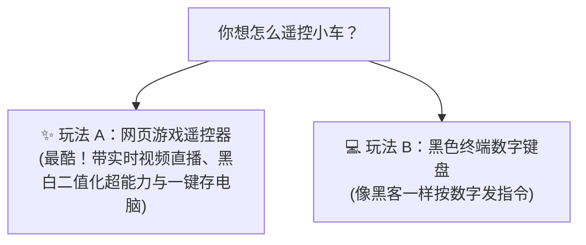

# 🚗 闪电小车启动与遥控指南（小学生也能懂的保姆级教程）

欢迎来到智能小车的世界！这个文档是为你准备的“玩具遥控秘籍”。只要跟着这 5 个简单步骤，你就能像玩遥控赛车一样轻松让小车跑起来、拍照和探索赛道！

---

## 🛑 冒险第一步：安全第一，别让小车“摔跤”！

> [!CAUTION]
> **绝对不能把小车直接放在高桌子上开机！**  
> 小车跑得很快，万一它往前冲掉在地上，主板和轮子会摔疼坏掉。
> 
> **请务必找一个结实的水杯或者小盒子，垫在小车的肚子下面，让它的 4 个轮子悬空浮在空中！**  
> （就算轮子飞速转动，小车也只是在原地踏步，绝对不会摔在地上。）

---

## 🔋 冒险第二步：给小车“通上魔法电流”

1. **找到电池盒**：在小车上找到装电池的盒子，上面有一个小小的拨动开关；
2. **推到 ON**：把开关推到 **ON**（开）。这时候驱动板上的小彩灯会亮起来，代表小车的“肌肉”已经有力气了；
3. **连上电脑与网络**：
   - **纯无线自由跑（最推荐）**：小车开机后会自动连上我们的手机热点（热点名称 `123456`），完全不用插线，可以在地上到处跑！
   - **插着线调试（最稳保底）**：如果用白色的 Type-C 线插在电脑上，电脑和小车就算没有网络也能通过专用通道稳定通信！

---

## 🎮 冒险第三步：选择你喜欢的“遥控器”玩法

小车有两个超棒的遥控器，你想选哪一个？



---

### ✨ 玩法 A：打开网页当小车驾驶员（最推荐，超级好玩！）

1. **打开小车的仪表盘**：
   在电脑或手机的浏览器地址栏输入这串神奇数字：
   - 如果是**拔掉线的无线遥控**，输入：
     ```text
     http://192.168.43.30:8080
     ```
   - 如果是**插着 Type-C 线**，输入：
     ```text
     http://192.168.128.10:8080
     ```

2. **怎么开车？**
   - **按住就跑，松开就停**：用鼠标（或手指）**按住**方向盘上的【前进 ▲】，小车就会往前开；**松开手指，小车瞬间自动刹车**，再也不怕撞墙！
   - **键盘操控**：按键盘上的 <kbd>W</kbd> 前进、<kbd>S</kbd> 后退、<kbd>A</kbd> 向左转、<kbd>D</kbd> 向右转。
   - **换挡变慢/变快**：拖动调速滑块，想让小车慢吞吞散步就拉低，想让它巡航就拉到中间档位。

3. **看小车的大眼睛（最新升级的双模超能力！）：**
   - **超流畅实时直播**：屏幕中间会像看电视直播一样，以每秒 18 张的速度实时播放小车前方看到的画面，延迟极低（动一下手画面立刻跟着动）！
   - **黑白赛道透视眼（一键切换）**：点击【🏁 赛道二值化】按钮，小车就像戴上了“特工透视镜”，把五颜六色的世界一瞬间变成黑白二值图，地上的黑线会清清楚楚凸显出来！点击【🌈 彩色原图】即可一秒切回真实色彩。
   - **照片直接存进电脑**：看到好玩或者关键的赛道画面，点击【💾 抓拍并下载到电脑】，照片直接“嗖”的一声自动存入你电脑的 **“下载 (Downloads)”** 文件夹里，就像在网页上保存表情包一样简单！
   - **小探头状态灯**：下方还有 4 个绿色小灯泡，如果小车踩在黑线上，对应的小灯泡就会熄灭，踩在白地上就会发亮。

---

### 💻 玩法 B：在黑色窗口里按数字发口令（极客模式）

在电脑的 VS Code 黑色终端窗口中，输入并回车：
```bash
python3 ~/RBE201TC/terminal_console.py
```
屏幕上会跳出一个整齐的菜单，你只要按下数字键盘：
- 按 **`1`**：小车平稳往前开；
- 按 **`0`**（或者按一下大空格键）：小车**立刻刹车停住**！
- 按 **`w`**：小车往前迈一小步（走 1.5 秒后自己停下来）；
- 按 **`s`**：小车往后退一小步；
- 按 **`5`**：看看底盘下的 4 个小探头看到的是黑线还是白地；
- 按 **`6`**：咔嚓一下拍一张照片！

---

## 🏁 冒险第四步：让小车开启“自动寻路巡线”（大作业模式）

如果你想让小车自己长眼睛，顺着地上的黑线自动开，并在遇到横向标记黑线时自动测量温湿度：

1. 把小车平稳放在赛道黑线上（车头的探头对准黑线）；
2. 在黑色终端窗口输入：
   ```bash
   sudo python3 ~/RBE201TC/line_follower.py
   ```
3. 小车就会顺着黑线平稳巡航，遇到黑线标记时车体会继续前进，同时悄悄把采集到的温度和湿度存进日记本（CSV 文件）里；
4. 如果你想让小车停下来，只要按一下键盘上的 **`Ctrl + C`**，小车就会乖乖刹停关机。

---

## 🚨 冒险第五步：遇到意外时的“救命绝招”！

万一小车不听话或者要撞桌角了，不要慌张：
1. **第一招（按键刹车）**：在键盘上猛按一下 **`空格键 (Space)`** 或者按 **`Ctrl + C`**；
2. **第二招（拔掉电源）**：直接伸手把电池盒上的开关拨回 **OFF**（或者拔掉电池插头），小车立刻彻底断电！

---

## 💡 小小魔法贴士：如果电脑里的代码更新了，怎么让小车知道？

电脑是“设计图本”，小车是“执行小机器人”。如果在电脑里修改了 `web_controller.py`，只要在电脑的黑色终端敲一句传送咒语：
```powershell
scp "E:\y3s1_learning\RBE201\file\Sources\RBE201TC\web_controller.py" sunrise@192.168.43.30:~/RBE201TC/web_controller.py
```
（输入密码 `sunrise`），最新鲜的魔法代码就会立刻飞进小车的大脑里啦！

